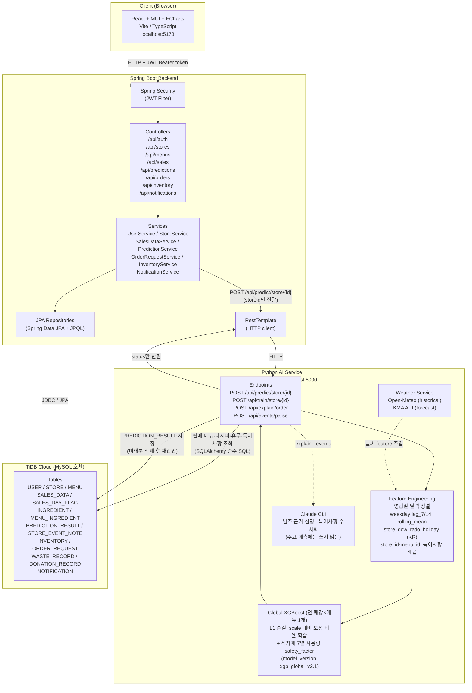

# FoodGuard - System Architecture

## 기술 스택 상세

| 계층 | 기술 |
|------|------|
| Frontend | React 18, TypeScript, Vite, MUI v5, Apache ECharts, React Router v6 |
| Backend | Spring Boot 3.x, Spring Security, Spring Data JPA, Lombok, JWT (jjwt) |
| AI Service | Python 3.11, FastAPI, XGBoost (글로벌 모델), scikit-learn, pandas, numpy, SQLAlchemy, Claude CLI(설명·특이사항) |
| Database | TiDB Cloud (MySQL 호환) |
| Weather | Open-Meteo API (historical, free), KMA 기상청 API (forecast) |

## 주요 설계 패턴
- **Role-Based Access**: JWT claim의 `role` 필드로 OWNER/HQ_ADMIN 분기
- **AI 트리거 방식**: Backend가 storeId만 담아 Python을 동기 HTTP 호출 → AI 서비스가 DB를 직접 읽어 글로벌 모델 학습·예측 후 `PREDICTION_RESULT`에 직접 저장. Backend는 결과를 DB에서 다시 읽음
- **주문 추천**: PredictionResult → MenuIngredient → (예측 필요량 - 현재재고 - 발주중) = 권장 발주량
- **주문 수령 자동화**: OrderRequest status = RECEIVED → Inventory.currentQty 자동 증가
