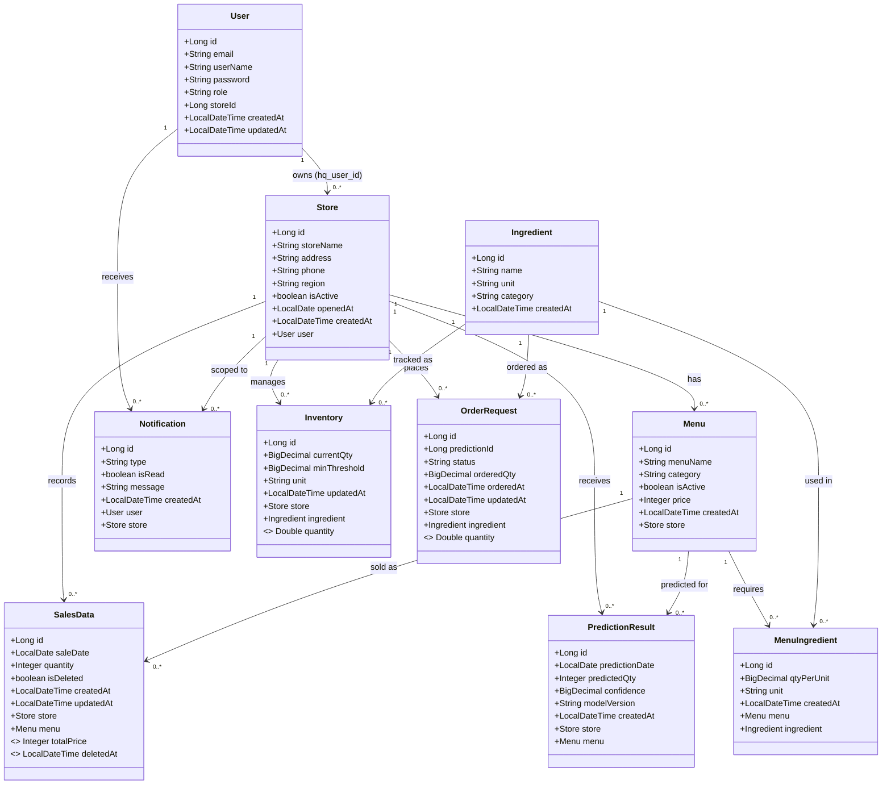

# FoodGuard - Class Diagram (Entity Layer)

## Role 설명
| Role | 설명 |
|------|------|
| `OWNER` | 개별 가맹점 점주. 자신의 가게 데이터만 접근 |
| `HQ_ADMIN` | 본사 관리자. 전체 가맹점 조회/통계 접근 |

## OrderRequest Status 흐름
`PENDING` → `APPROVED` → `RECEIVED`  
`PENDING` → `CANCELLED`
