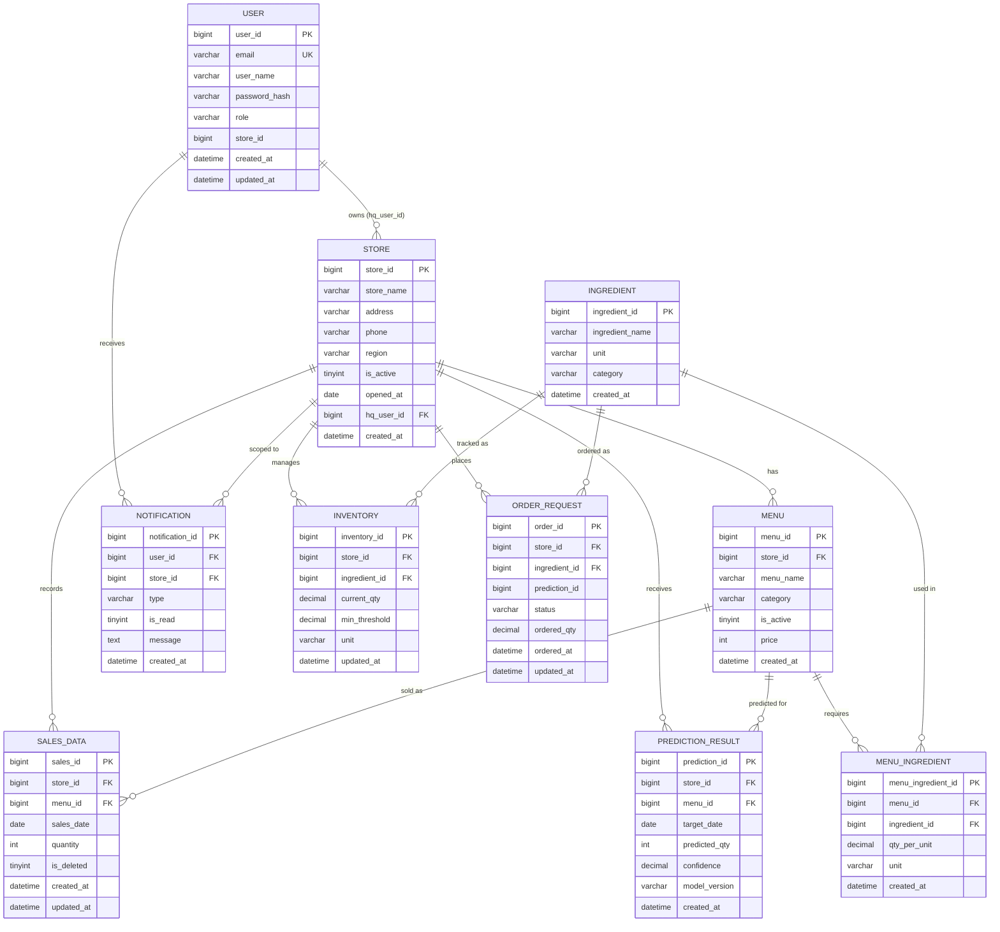

# FoodGuard - ER Diagram

## 주요 설계 결정
- `SALES_DATA.total_price` — DB에 저장하지 않음 (`@Transient`). 매출 집계는 `SUM(quantity * menu.price)` JPQL로 계산
- `ORDER_REQUEST.prediction_id` — FK 제약 없이 단순 Long 컬럼 (nullable). 예측 기반 주문임을 표시
- `INVENTORY.current_qty` / `OrderRequest.ordered_qty` — BigDecimal (소수점 지원)
- Soft delete: `SALES_DATA.is_deleted = 1`로 논리 삭제
