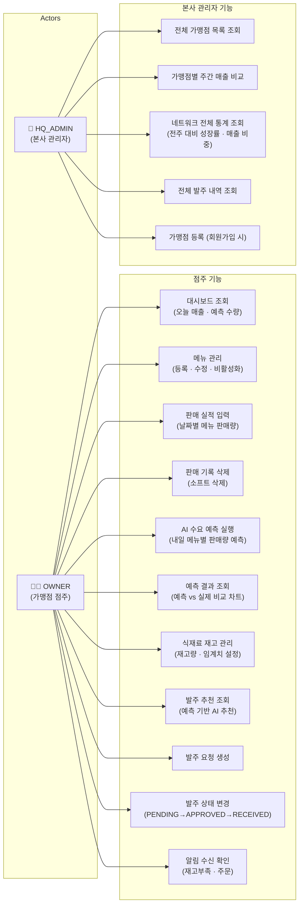

# FoodGuard - Use Case Diagram

## 페이지 ↔ 기능 매핑

| 페이지 | 경로 | 역할 | 핵심 기능 |
|--------|------|------|-----------|
| Dashboard | `/dashboard` | OWNER | 오늘 매출, 내일 예측, 알림 수 |
| 메뉴 관리 | `/menus` | OWNER | 메뉴 CRUD |
| 판매 실적 입력 | `/sales` | OWNER | 판매 데이터 입력 · 삭제 |
| AI 수요 예측 | `/predictions` | OWNER | 예측 실행 · 결과 차트 · 과거 판매 현황 |
| 재고 관리 | `/inventory` | OWNER | 재고 조회 · 수정 |
| 발주 관리 | `/orders` | OWNER | 추천 발주 · 발주 CRUD · 상태 변경 |
| 알림 | `/notifications` | OWNER | 알림 목록 · 읽음 처리 |
| 가맹점 관리 | `/admin/stores` | HQ_ADMIN | 전체 가맹점 · 주간 매출 차트 |
| 통계 | `/admin/stats` | HQ_ADMIN | 네트워크 매출 통계 · 비교 차트 |
| 발주 내역 | `/admin/orders` | HQ_ADMIN | 전체 발주 현황 |
